  

 

---

## 👨‍💻 About Me

I am a student at **Institut Teknologi Del** with a strong passion for frontend development. My work focuses on building clean, intuitive, and responsive user interfaces with accessible design systems. I am also actively exploring artificial intelligence integrations and modern software architecture.

| 🚀 Focus | 📚 Currently Studying | 🤝 Open To |
|:---|:---|:---|
| Frontend development with React & Next.js | Artificial Intelligence & ML | Collaborative web & open-source projects |
| Responsive, modern & accessible UI/UX design | Project Management & Agile Methodologies | Technical discussions & peer learning |
| High-performance client-server integration | Scalable software architecture | Mentoring & knowledge exchange |

---

## 🛠️ Technical Skills

<b>🎨 Frontend & UI/UX Design</b>

 

<b>⚙️ Backend & Databases</b>

 

<b>📱 Mobile & DevOps Tools</b>

 

---

## 📂 Selected Projects

| Project | Description | Tech Stack |
|:---|:---|:---|
| [**Catatan Belajar Ngoding**](https://github.com/lysonmnk/ifs24024-pabwe2026-proyek1) | Learning notes web application developed for PABWE 2026, featuring decoupled client-server architecture. | `React` `NestJS` |
| [**ControlFlowCoverage**](https://github.com/lysonmnk/ControlFlowCoverage) | Automated white-box software testing analysis implementing control-flow graph coverage criteria. | `Software Testing` `Analysis` |
| [**pemfung**](https://github.com/lysonmnk/pemfung) | Functional programming explorations and problem-solving implementations covering core FP paradigms. | `Functional Programming` |

---

## 📊 GitHub Statistics

  
  

  

  

---

## 📬 Connect with Me

- 💬 **Discord**: [discord.gg/lysonmnk](https://discord.gg/lysonmnk)
- 🐙 **GitHub**: [@lysonmnk](https://github.com/lysonmnk)
- ✉️ **Email**: [lysonmanik30@gmail.com](mailto:lysonmanik30@gmail.com)
